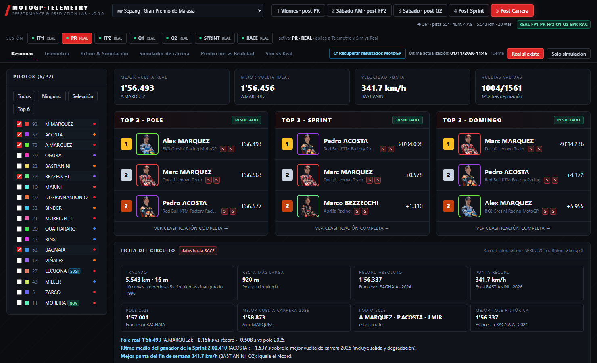
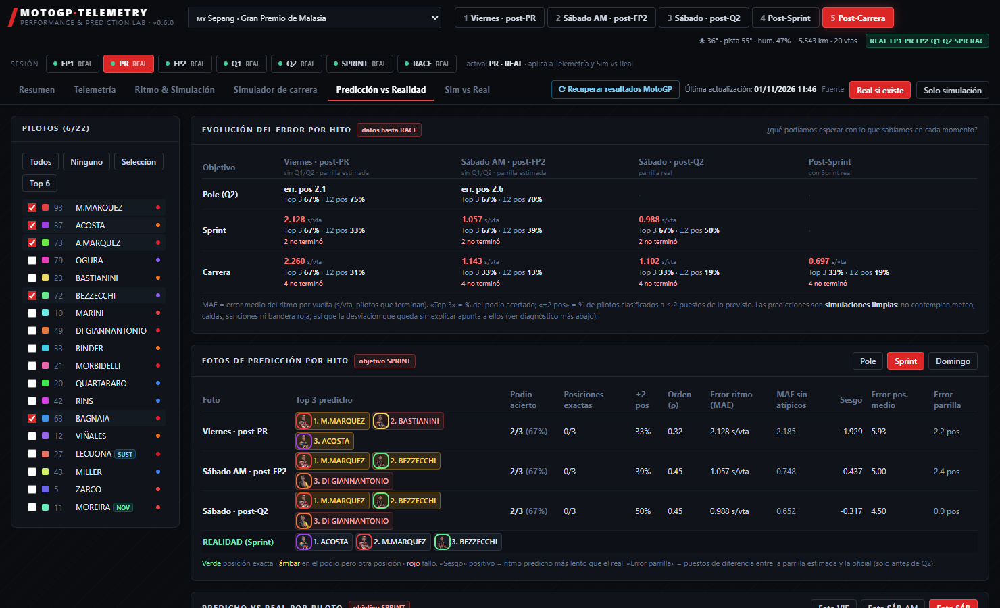
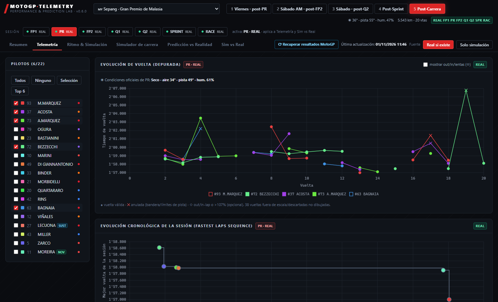
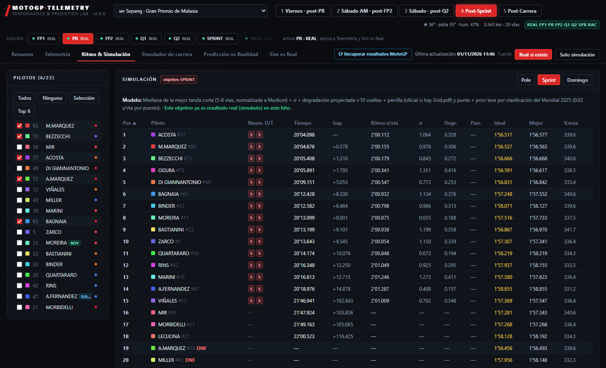
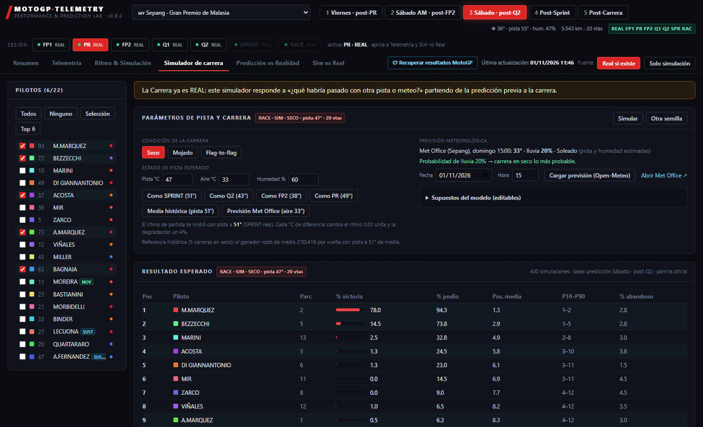
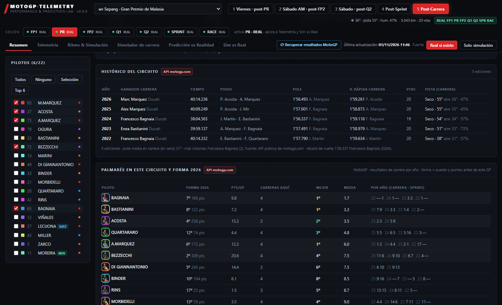
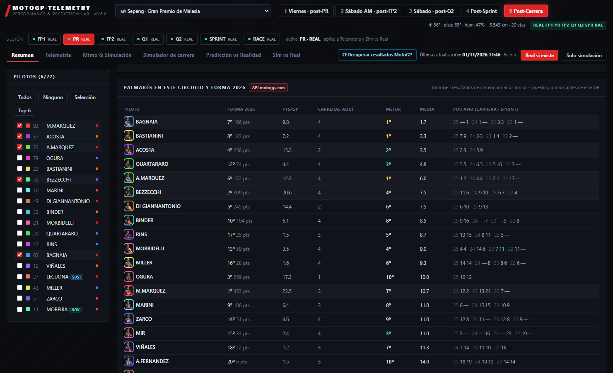
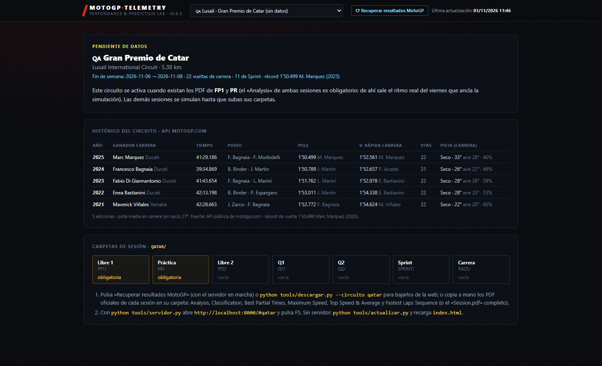

# MotoGP Telemetry · Performance & Prediction Lab

Panel web de una sola página que lee los PDF oficiales de cronometraje de MotoGP y los datos de la API pública de motogp.com para analizar un fin de semana de Gran Premio, **predecir** Pole, Sprint y Carrera en cada punto del fin de semana y **medir cuánto acertó** cada predicción.

Incluye como ejemplo el Gran Premio de Malasia 2026 (Sepang) completo, de FP1 a la Carrera. El manual completo de instalación, uso y despliegue está en [`README.txt`](README.txt); las novedades de cada versión, en [`CHANGELOG.md`](CHANGELOG.md).



## Puesta en marcha

```bash
# Windows: doble clic en instalar.bat, después en iniciar.bat
# Linux / macOS
./instalar.sh && ./iniciar.sh
```

Se abre en <http://localhost:8000>. Con el servidor en marcha, el botón **«Recuperar resultados MotoGP»** de la cabecera baja los PDF y los datos nuevos de motogp.com, y **F5** reconstruye el panel con lo que haya en las carpetas.

## Funcionalidades

### Lectura y depuración de datos
- Lee los PDF oficiales de cada sesión (Analysis, Classification, Best Partial Times, Maximum Speed, Top Speed & Average, Fastest Laps Sequence, Qualifying Results, Grid, Lap Chart, Fastest Lap of each Rider, Analysis by Lap, Session) y los del evento (Entry, Entry Biographical, Circuit Information, Event Maximum Speed).
- **Validación cruzada** entre informes: clasificación contra vueltas, parciales contra sectores, velocidades contra Analysis, parrilla contra Lap Chart.
- Depura las vueltas: out-laps, in-laps, anuladas por bandera o límites de pista, lentas (>107 %) y las hechas con neumático de lluvia en seco.
- **Vuelta ideal** (suma de los mejores sectores acumulados), margen real − ideal y velocidades punta.
- Reconoce las sustituciones, los pilotos que no toman la salida y los incidentes de dirección de carrera.

### Predicción en cinco hitos
- Viernes post-PR · Sábado AM post-FP2 · Sábado post-Q2 · Post-Sprint · Post-Carrera, usando **solo lo conocido en cada hito**.
- **Pole** (ajustada a la mejor vuelta posible), **Sprint** y **Carrera** con ritmo, degradación, neumático delantero/trasero, parrilla oficial, punta y un prior suave por la clasificación del Mundial.
- Confianza de cada predicción y Top 3 con **foto de cada piloto**.
- Evolución esperada de la pista y normalización del ritmo por compuesto.

### Predicción vs Realidad
- Error de ritmo por hito y por piloto, podio acertado, correlación de posiciones.
- **Diagnóstico de la desviación**: desfase común del campo (meteo), caídas y abandonos de los informes oficiales, valores atípicos.
- Gráfica de degradación **proyectada vs real**.
- Pestaña **Sim vs Real**: cada sesión simulada frente a su versión real.



### Telemetría
- Evolución de vuelta depurada, sectores, vuelta ideal, velocidades punta, evolución cronológica de la sesión (Fastest Laps Sequence).
- Dirección de carrera, salida y posiciones ganadas en la primera vuelta (Lap Chart).
- Condiciones oficiales de cada sesión (aire, pista, humedad).



### Ritmo y simulación



### Simulador de carrera
- Simulación Monte Carlo vuelta a vuelta partiendo de la mejor predicción disponible.
- Condición **seco, mojado o flag-to-flag** (seco→mojado o mojado→seco, vuelta del cambio, pérdida por cambio de moto).
- Estado de pista editable: temperatura de pista, aire y humedad, o «como la Sprint», «media histórica» o previsión.
- Previsión de **Open-Meteo** desde el navegador y enlace al Met Office.
- Probabilidad de victoria y podio, posiciones y huecos vuelta a vuelta, caídas.



### Datos de la API de motogp.com
- **Recuperar resultados MotoGP**: botón en la cabecera, con la **fecha de la última actualización** siempre visible.
- Descarga de todos los PDF de la web: *Session Results*, *Event Results* y *Championship Results* (Season Statistics, Nations, Riders Performance, Pole Positions, Podiums, Riders All Time).
- Clasificación del Mundial, estadísticas de temporada y de carrera de cada piloto y calendario.
- **Histórico del circuito** (últimas ediciones: podio, pole, vuelta rápida, condiciones, vueltas) y **palmarés de cada piloto** en el trazado.




### Varios circuitos y despliegue
- Un selector con Malasia (datos reales), Mandalika, Portimão, Lusail y Valencia. Los siguientes circuitos ya traen fecha, vueltas, récord e histórico desde la API aunque aún no haya PDF.
- Sesiones sin PDF simuladas y marcadas como **SIMULADO**; interruptor «Real si existe / Solo simulación».
- Instaladores y arranque para Windows y Linux, servidor local que reconstruye con F5, o fichero estático autocontenido.



## Estructura

```
index.html            panel generado (autocontenido)
instalar.* iniciar.*  instalación y arranque
tools/                lectura de PDF, motor de predicción, interfaz, servidor, descargas
API/                  datos de la API pública: Mundial, pilotos, histórico por circuito, última actualización
MALASYA/ …            un directorio por circuito, con una carpeta por sesión
docs/capturas/        capturas de pantalla de este README
```

## Versiones

La versión actual es la **0.6.0**. Qué trae cada una está en [`CHANGELOG.md`](CHANGELOG.md).

## Aviso

Los PDF y los datos pertenecen a MotoGP / Dorna. El proyecto los usa en privado, con una petición a la vez y sin sobrecargar el servicio. Las predicciones son orientativas.
